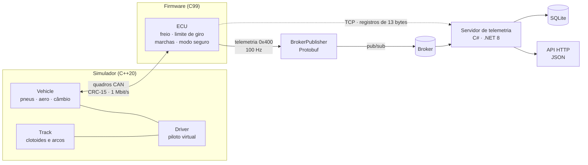

<div align="center">

# 🏎️ Apex Sim

**Simulador didático de carro de corrida, do pneu ao painel de telemetria.**
Física em C++20, firmware de ECU em C99 e servidor de telemetria em C#, ligados por um barramento CAN simulado e por um broker pub/sub com Protobuf.

[](https://github.com/Alexandre-arocha/apex-sim/actions/workflows/ci.yml)


</div>

---

## ✨ Em números

| | |
|---|---|
| 🏁 Volta lançada no circuito de referência (2 215 m) | **45,31 s** |
| 🚀 Velocidade máxima na volta | **304 km/h** |
| ⏱️ Passo de simulação | **1 ms** |
| 📡 Telemetria | **100 Hz** |
| 🚌 Ocupação do barramento CAN a 1 kHz | **~43 %** |
| ✅ Testes | **~120 em C++ · 47 em C#** |

## 🧩 Arquitetura



## 📦 O que tem aqui

### 🔧 Física (`src/`, `include/sim/`)
- **Carro de quatro rodas** em passo fixo de 1 ms: motor com curva de torque, câmbio com corte de torque na troca, arrasto, downforce, resistência de rolamento, freio e esterço.
- **Pneu de Pacejka simplificado** (`Fy = D sin(C atan(B α))`) com atrito que cai com a carga, transferência de carga longitudinal e lateral e círculo de atrito por roda.
- **Pista** descrita por perfil de curvatura (retas, arcos e clotoides), amostrada a cada ~1 m, com cronômetro de voltas.
- **Piloto virtual** que calcula o limite de velocidade de cada ponto (curva e frenagem para as seguintes) e guia o carro pela linha. Na referência: picos de 2,7 g em curva e 4,4 g de frenagem, a no máximo 0,68 m da linha.

### 🧠 ECU (`src/ecu.c`, `include/ecu/ecu.h`)
Firmware em C99, **sem alocação dinâmica**, com um `ecu_step` por milissegundo: o freio vence o acelerador, o torque é cortado aos poucos entre 14 500 e 15 000 rpm, a ECU escolhe as marchas, entra em **modo seguro** se faltar o quadro do piloto e emite telemetria a 100 Hz. O CI compila o firmware para **Cortex-M4** com `-Werror` e confere que não há `malloc`.

### 🚌 CAN (`include/can/`, `can/sim.dbc`)
Quadros de sensores `0x100`, piloto `0x200`, atuadores `0x300`, marcha `0x310` e telemetria `0x400`, com **CRC-15**. O barramento simulado (`CanBus`) faz arbitragem pelo menor id, conta o tempo real de cada quadro (pior caso de bit stuffing) e retransmite quando o CRC acusa erro: com 2 % dos quadros corrompidos, a volta fica a menos de 2 % da volta sem erros. As definições estão também em formato DBC, e um teste exige os mesmos bytes que o código C produz.

### 📡 Telemetria (`server/`, `proto/`)
- **Servidor C#** que recebe a telemetria por TCP, guarda a sessão a 100 Hz, detecta as voltas, devolve canais (`speed`, `rpm`, `throttle`, `brake`, `gear`) e reamostra por interpolação.
- **SQLite** para persistência (gravação em lotes de 250 ms) e **API HTTP** em JSON.
- **Broker pub/sub próprio** em TCP com **Protobuf**: tópicos exatos ou por prefixo (`telemetry.*`), fila limitada por assinante e preenchimento de lacunas na sequência de amostras.
- **Cliente em C++** (`TelemetryClient`, `BrokerPublisher`) que publica direto do simulador.

## 🚀 Como usar

### Biblioteca de física

```cpp
#include "sim/vehicle.hpp"

sim::Vehicle car{sim::VehicleParams{}};                    // parâmetros de referência (~F1)
car.step({.throttle = 1.0, .brake = 0.0, .steer = 0.1});   // avança exatamente 1 ms
const auto& s = car.state();                               // tempo, posição, velocidades, rpm, marcha, forças, cargas
```

### Build e testes (C++)

```bash
cmake -S . -B build -DCMAKE_BUILD_TYPE=Release   # avisos como erro; desligue com -DSIM_WARNINGS_AS_ERRORS=OFF
cmake --build build
ctest --test-dir build --output-on-failure
```

GoogleTest vem do sistema ou é baixado via `FetchContent`. Com sanitizadores (ASan + UBSan):

```bash
cmake -S . -B build-asan -DCMAKE_CXX_COMPILER=clang++ -DCMAKE_BUILD_TYPE=Debug -DSIM_SANITIZE=ON
cmake --build build-asan && ctest --test-dir build-asan --output-on-failure
```

### Servidor de telemetria (C#)

```bash
dotnet test server/SimTelemetry.Tests
dotnet build server/SimTelemetry.Cli -c Release
```

| Modo | Comando |
|---|---|
| Receber por TCP e imprimir as voltas | `SimTelemetry.Cli <porta> <comprimento-da-pista-m> [timeout-s]` |
| Servidor com banco e API HTTP | `SimTelemetry.Cli serve <banco.db> <porta-tcp> <porta-http> [comprimento-m] [--broker host:porta]` |
| Broker pub/sub | `SimTelemetry.Cli broker <porta> [tamanho-da-fila]` |
| Assinar e imprimir um tópico | `SimTelemetry.Cli consume <host:porta> [tópico] [máximo]` |

### Ponta a ponta: simulador → broker → servidor → API

```bash
# terminal 1: broker
dotnet server/SimTelemetry.Cli/bin/Release/net8.0/SimTelemetry.Cli.dll broker 5060

# terminal 2: servidor que grava o que passa pelo broker
dotnet server/SimTelemetry.Cli/bin/Release/net8.0/SimTelemetry.Cli.dll serve sessoes.db 5055 8080 --broker 127.0.0.1:5060

# terminal 3: simulador publicando duas voltas
./build/sim_telemetry_dump - 2 broker:127.0.0.1:5060

# consultar
curl http://127.0.0.1:8080/sessions/1/laps
```

### API HTTP

| Rota | Descrição |
|---|---|
| `GET /sessions` | lista as sessões |
| `POST /sessions` | abre uma sessão nova |
| `GET /sessions/{id}` | detalhes e voltas |
| `GET /sessions/{id}/laps` | voltas |
| `GET /sessions/{id}/channels/{canal}?rate=&from=&to=` | canal reamostrado (ou `?lap=N`) |

### Faixas públicas de F1

`tests/validation_test.cpp` confere o carro de referência contra faixas públicas de F1. As faixas vêm de resumos públicos de qualidade mista ([Autosport](https://www.autosport.com/f1/news/how-fast-is-an-f1-car-top-speeds-of-f1-indycar-motogp-and-more-4980734/4980734), [F1 Chronicle](https://f1chronicle.com/f1-g-force-how-many-gs-can-a-f1-car-pull), [Mercedes-AMG F1](https://www.mercedesamgf1.com/news/feature-downforce-in-formula-one-explained), [fórum f1technical](https://www.f1technical.net/forum/viewtopic.php?p=384896), entre outros); nenhuma é dado oficial da FIA ou de equipe.

| Grandeza | Faixa pública | Modelo |
|---|---|---|
| 0–100 km/h | 2,4–2,8 s | 2,48 s |
| 0–200 km/h | 4,5–5,5 s | 4,51 s |
| 0–300 km/h | 8,4–10,6 s | 8,83 s |
| Velocidade máxima (reta, 200 s) | 320–375 km/h | 338 km/h |
| Frenagem de pico, de 300 km/h | 5–6 g | 5,6 g |
| Downforce / peso a 150 e 300 km/h | ~1× e 3–4× | 0,71× e 2,83× |
| Sustentação / arrasto | ~4 | 4,0 |
| Lateral em curva rápida (~300 km/h) | 5–6 g | exigido 4,5–6,5 g |

O 0–100 e o 0–200 ficam no limite inferior das faixas e a lateral em curva rápida no inferior da faixa pública. Os números de 0–100, 0–200 e 0–300 foram ajustados até cair nas faixas: dimensão de arrasto 1,0 → 1,3 m², de sustentação 4,0 → 5,2 m² (mesma razão de 4), atrito do pneu traseiro 1,9 → 1,7 e do dianteiro 1,7 → 1,6 (o par 1,7/1,7 deixava o piloto rodar de traseira). Efeito colateral: a volta lançada ficou 0,3 s mais lenta (44,98 → 45,31 s). A massa do modelo é 798 kg; as fontes consultadas citam 795 kg para 2022, e não confirmei 798 kg.

### Telemetria real (OpenF1)

`tools/validate_openf1.py` (só biblioteca padrão, sem chave, nada gravado) busca na [OpenF1](https://openf1.org) a largada e a volta mais rápida de um piloto na corrida e imprime o envelope. A pista do simulador é fictícia, então só o que não depende dela é comparável. Rodei no GP da Itália de 2024 (Monza) com 8 pilotos; um não tinha dados e dois (largada lenta, 13 s até 100 km/h) foram descartados. A telemetria real vem a ~3,7 Hz e os números abaixo são dos 5 pilotos restantes:

| Grandeza | Real (OpenF1, Monza 2024) | Modelo |
|---|---|---|
| 0–100 km/h na largada | 2,74–4,72 s | 2,48 s |
| 0–200 km/h na largada | 5,20–7,68 s | 4,51 s |
| Velocidade máxima na volta rápida | 334–341 km/h | 338 km/h (reta de 200 s) |
| Marcha máxima | 8 | 8 |
| Frenagem de pico (média entre amostras, >200 km/h) | 4,3–6,2 g | 5,6 g |
| Giro máximo | 11 954–12 338 rpm | corte em 15 000, troca de marcha em 14 000 |

Leitura honesta: velocidade máxima, marchas e frenagem de pico caem no mesmo patamar. O modelo acelera mais forte que o carro real: ficou 0,3 s abaixo do melhor 0–100 e 0,7 s abaixo do melhor 0–200 (a janela de 3,7 Hz pode antecipar o início real em até 0,27 s, o que explica só parte). E o modelo gira muito mais alto (corte em 15 000 rpm, troca em 14 000) do que o carro real em Monza, que não passou de ~12 300 rpm nas amostras; não mexi nisso porque a curva de torque e as relações de marcha foram calibradas juntas com esse regime. Não comparei aceleração lateral (a OpenF1 não tem) nem a volta (pista diferente). Os dados não foram guardados no repositório, só os números derivados acima.

## ⚠️ Simplificações conscientes

- Sem marcha à ré: o carro só anda para trás se rodar e deslizar.
- Sem freio-motor: acelerador 0 deixa só arrasto e rolamento.
- Sem dinâmica de giro das rodas: o pneu entrega a força longitudinal pedida até o círculo de atrito.
- Chassi rígido: a carga das rodas responde à aceleração do passo anterior, sem suspensão.
- Na largada a embreagem patina e mantém o motor em `clutch_launch_rpm`.
- Parâmetros de referência são ordem de grandeza de F1, não dados de uma equipe.
- A ECU (C99, sem `malloc`) é compilada no CI para Cortex-M4 com `arm-none-eabi-gcc -Werror`, e o CI confere que ela não usa alocação dinâmica; mas não foi gravada nem rodada em placa ou emulador. O barramento simulado é um só (sem vários barramentos nem gateway), calcula os bits de cada quadro no pior caso de bit stuffing em vez de transmitir o fluxo real e não tem os estados de erro do padrão (error-passive, bus-off).
- A ECU escolhe as marchas (quadro `0x310`); o `Vehicle` as executa, com o corte de torque na troca, e só usa o câmbio automático próprio quando nenhuma marcha é pedida (`Controls.gear_request = 0`).
- A telemetria vai por TCP direto, em registros de 13 bytes (id, dlc, dados); o caminho com Protobuf e broker é o do item seguinte. O simulador em C++ envia a telemetria ao servidor por TCP (`TelemetryClient`, Winsock no Windows e sockets POSIX nos demais; `sim_telemetry_dump - 2 host:porta`), e o CI sobe o servidor de linha de comando (`server/SimTelemetry.Cli`) e confere que todos os quadros e as 2 voltas chegam. O cliente não reconecta nem enfileira: se o servidor cai, o envio para com erro. O caminho Winsock só foi compilado, não executado.
- As sessões ficam num banco SQLite (`SessionStore`) e são consultadas por uma API HTTP em JSON (`TelemetryApi`): `GET /sessions`, `POST /sessions`, `GET /sessions/{id}`, `GET /sessions/{id}/laps` e `GET /sessions/{id}/channels/{canal}?rate=&from=&to=` (ou `?lap=N`). `SimTelemetry.Cli serve banco.db <porta-tcp> <porta-http> [comprimento-m]` recebe a telemetria por TCP, grava em lotes de 250 ms e responde pelo HTTP. Só uma sessão grava de cada vez (a que o `POST /sessions` abriu por último); sem sessão ativa os quadros são descartados e contados. A API não tem autenticação nem TLS e escuta só em `127.0.0.1`; uma consulta carrega a sessão inteira na memória. As voltas saem da distância integrada da velocidade, porque o quadro de telemetria não leva posição.
- Protobuf e broker: `proto/telemetry.proto` (`TelemetrySample`, `SessionStart`) e `proto/broker.proto` (`Subscribe`, `Publish`, `Ack`) são o contrato. O broker (`BrokerServer`, `SimTelemetry.Cli broker <porta>`) é um pub/sub próprio em TCP, não é MQTT nem Kafka: quadros com 4 bytes de tamanho (big-endian, de 1 byte a 1 MiB) e a mensagem Protobuf; tópicos exatos ou prefixo terminado em `*`; entrega no máximo uma vez, sem persistência nem reentrega (quem não está inscrito perde a mensagem); fila limitada por assinante (padrão 1024, a CLI usa 65 536), em que o assinante lento perde as mensagens mais antigas dele, contadas em `Stats.Dropped`, sem atrasar os outros; quadro ou mensagem inválida derruba só a conexão que a mandou. Sem autenticação nem TLS, e só no loopback por padrão. `serve ... --broker host:porta` liga o servidor ao broker (`TelemetryBridge`): `session.start` abre uma sessão e cada `telemetry.sample` leva um número de sequência; se a sequência pula, a ponte repete a última amostra para o tempo da sessão não andar errado (contado em `GapsFilled`), e amostras repetidas ou atrasadas são ignoradas. O simulador publica com `sim_telemetry_dump - 2 broker:host:porta` e `SimTelemetry.Cli consume host:porta [tópico]` mostra o que passa. O lado C++ codifica à mão as três mensagens (`src/broker_publisher.cpp`), sem a biblioteca Protobuf: não havia `protoc` no ambiente de desenvolvimento e assim o build não ganha dependência. O que prende os dois lados são os mesmos bytes de referência conferidos nos testes de C# (código gerado pelo `protoc`) e de C++, e o job `broker-e2e` do CI, que confere gravação completa, 2 voltas e a sequência inteira sem buraco; mas um campo novo no `.proto` precisa ser acrescentado à mão no codificador C++.
- Os quadros estão descritos em `can/sim.dbc` (formato DBC); um teste codifica valores só pelo que o arquivo diz e exige os mesmos bytes que o código C produz. O arquivo não gera o código: os dois são mantidos à mão e o teste é que os prende. O registro de 13 bytes da telemetria no fio TCP não leva o CRC.
- A pista é só a linha que o piloto segue: não tem largura, zebras nem relevo.
- O piloto não se recupera de uma rodada: pedindo mais aderência do que os pneus têm (`grip_usage` acima de ~1), ele sai da pista.
